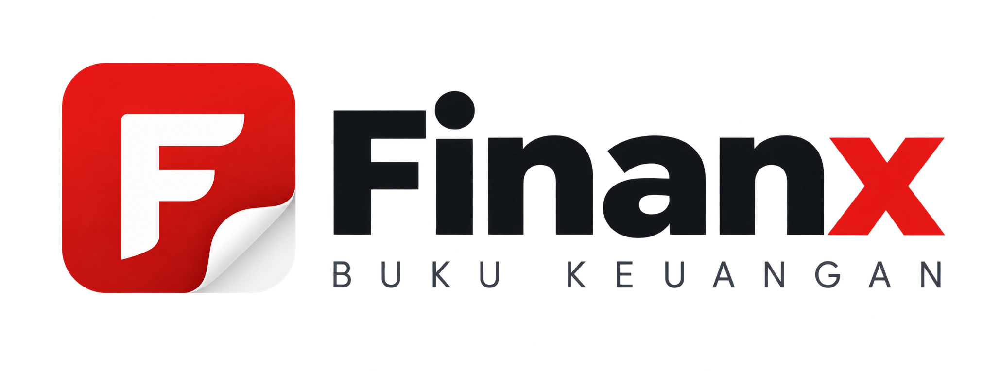

# Finanx v1.0.0



Finanx adalah buku keuangan pribadi berbasis web untuk mencatat pemasukan dan pengeluaran, mengelompokkan transaksi, dan melihat ringkasan bulanan. Rilis ini merupakan baseline resmi pertama produk.

> Arah desain: uang diperlakukan seperti buku register yang dicap—setiap transaksi adalah satu baris yang dicatat dengan cepat dan tenang.

## Fitur v1

- Tambah, edit, soft delete, dan urungkan penghapusan transaksi.
- Pemasukan dan pengeluaran dengan jumlah, kategori, tanggal, dan keterangan opsional.
- Tanggal transaksi masa lalu, hari ini, maupun masa depan.
- Dashboard bulanan: pemasukan, pengeluaran, saldo, perbandingan, dan rincian kategori.
- Daftar transaksi dengan filter jenis, kategori, Januari–Desember, pencarian, dan pagination.
- Kategori sistem dan kategori kustom.
- Bahasa Indonesia dan Inggris.
- Profil pengguna, informasi versi, dan logout.
- Mode demo lokal serta mode cloud Supabase opsional.
- Antarmuka responsif untuk ponsel, tablet, dan desktop.

## Teknologi

- React 18 dan Vite 6.
- Supabase Auth + Postgres + RLS untuk mode cloud.
- `localStorage` untuk mode demo.
- Inter dan IBM Plex Mono.

## Menjalankan aplikasi

Prasyarat: Node.js 18+ dan npm.

```bash
git clone https://github.com/surega02/finanx.git
cd finanx
npm install
npm run dev
```

Buka `http://localhost:5173`. Tanpa environment Supabase, aplikasi otomatis berjalan dalam mode demo dengan data contoh.

## Mode cloud

1. Buat proyek Supabase.
2. Jalankan [supabase/schema.sql](supabase/schema.sql) pada SQL Editor proyek baru.
3. Aktifkan Google OAuth di Supabase Authentication.
4. Salin `.env.example` menjadi `.env` dan isi:

```env
VITE_SUPABASE_URL=https://<project-ref>.supabase.co
VITE_SUPABASE_ANON_KEY=<anon-key>
```

5. Restart development server.

Panduan lengkap tersedia di [SUPABASE-v1.md](SUPABASE-v1.md).

## Build produksi

```bash
npm run build
npm run preview
```

Hasil build berada di `dist/`.

## Struktur utama

```text
finanx/
├── src/
│   ├── components/       UI aplikasi
│   ├── lib/              store, format, i18n, versi, Supabase
│   ├── App.jsx           context dan state root
│   └── styles.css        design system dan layout
├── supabase/
│   └── schema.sql        tabel, index, RLS, dan seed kategori
├── PRODUCT-v1.md
├── REQUIREMENTS-v1.md
├── DATA-MODEL-v1.md
├── DESIGN-v1.md
└── SUPABASE-v1.md
```

## Dokumentasi baseline v1

- [PRODUCT-v1.md](PRODUCT-v1.md) — tujuan, scope, dan prinsip produk.
- [REQUIREMENTS-v1.md](REQUIREMENTS-v1.md) — functional requirements dan acceptance criteria.
- [DATA-MODEL-v1.md](DATA-MODEL-v1.md) — model domain, skema Supabase, dan RLS.
- [DESIGN-v1.md](DESIGN-v1.md) — kontrak desain “The Stamped Register”.
- [SUPABASE-v1.md](SUPABASE-v1.md) — panduan konfigurasi mode cloud.

Dokumen berakhiran `-v1.md` adalah baseline dan tidak digunakan untuk menampung scope fitur baru.

## Memulai pengembangan berikutnya

Mulai setiap pengembangan baru dengan dokumen requirement baru, misalnya:

- `REQUIREMENTS-v1.1.md` untuk penambahan kompatibel dalam seri v1.
- `REQUIREMENTS-v2.md` untuk perubahan besar atau tidak kompatibel.

Gunakan template pada bagian akhir [REQUIREMENTS-v1.md](REQUIREMENTS-v1.md). Jelaskan perubahan dari baseline, migrasi data, dampak UI, keamanan, serta acceptance criteria. Buat `PRODUCT-v<versi>.md`, `DESIGN-v<versi>.md`, atau `DATA-MODEL-v<versi>.md` baru hanya bila area tersebut berubah.

## Batasan v1

V1 tidak mencakup akun/dompet, transfer, anggaran, transaksi berulang, target, utang/piutang, investasi, multi-mata-uang, lampiran, ekspor, notifikasi, kolaborasi, admin, dan laporan lanjutan.

## Lisensi

Privat — proyek internal.
